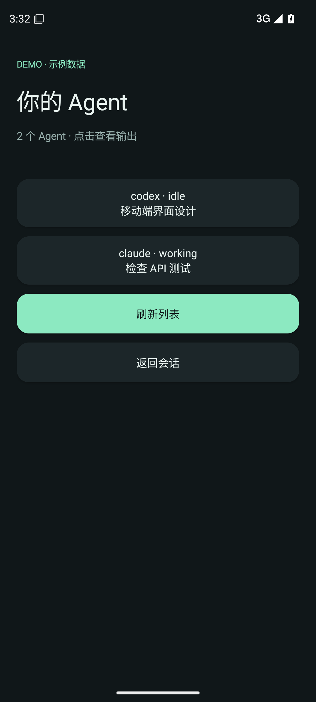

# Herdr Pocket

An independent, open-source Android companion for [Herdr](https://herdr.dev).
Built from scratch in Kotlin, with a small auditable Python bridge carried inside the APK.
Not affiliated with Herdr or other similarly named mobile apps.

**Status: v0.1.0 experimental.** Real SSH transport and Herdr CLI integration; not a chat-history sync service.

[Download experimental APK](https://github.com/HFO4AR/herdr-pocket/releases/tag/v0.1.0-alpha.1) · [Build checks](https://github.com/HFO4AR/herdr-pocket/actions)

 

Screenshots show offline demo data, not real conversations.

## 功能

- SSH 密码登录，首次连接显示 SHA-256 主机指纹，确认后固定密钥；密钥变化拒绝连接。
- 连接资料保存在 App 私有存储，密码只留在内存；不使用分析、广告或云端中转。
- 列出运行中的 Herdr 会话、Agent 及状态，读取最近终端输出。
- 给空闲 Agent 发送消息；方向键、Enter、Esc、Ctrl+C 均经用户确认发送。
- 桥接程序随 APK 分发，App 通过 SFTP 显式安装并回读校验，无需 sudo。
- 请求 ID 持久化去重；发送超时不会自动重试。
- 演示模式不连接服务器、不发送任何指令。

## Connect

1. On your computer, install Herdr and Python **3.9+**, enable SSH/SFTP, and start a Herdr session under the same user.
2. Build/install the Android APK (Android **8.0+**).
3. Enter your SSH host, port, user and password. Verify the displayed fingerprint against your server's public host key (e.g. `ssh-keygen -lf /etc/ssh/ssh_host_ed25519_key.pub -E sha256`).
4. Choose **安装 / 校验桥接程序**. The app uploads its bundled bridge to `~/.herdr-pocket/bridge-<sha256>.py`, then verifies protocol version 1.
5. Choose your Herdr session and Agent. Refresh output before interacting with approvals.

With Sakura Frp (including a client running on another LAN device), use a **TCP tunnel targeting the Herdr computer's SSH port**. Enter the tunnel's public hostname and assigned port in the app. Never commit tunnel credentials or real machine addresses.

Manual bridge installation is also available: run `python3 scripts/install_bridge.py` from the matching source version under the SSH user, then choose **读取会话** in the app.

The host remains responsible for SSH access policy. The phone uses the existing user's privileges. This app does not grant permission to operate physical equipment or bypass a project's approval rules.

## Build

Use JDK 17, Android SDK platform 35, and Build Tools 35.0.0. Set `ANDROID_HOME` or a git-ignored `local.properties` containing `sdk.dir=...`.

```sh
./gradlew assembleDebug lintDebug
python3 -m unittest discover -s tests -v
```

APK: `app/build/outputs/apk/debug/app-debug.apk`. Debug APKs use a development signing key and are intended for testing. Stable distribution with a protected release key is a separate milestone. GitHub Actions also produces a debug APK artifact.

## Bridge

One JSON request on stdin and one JSON response on stdout, carried through an SSH exec channel. No HTTP listener, shell prompt scraping or extra public port. The app quotes the bridge path; the bridge invokes Herdr with argv arrays, never a shell.

```sh
printf '%s\n' '{"v":1,"op":"hello"}' | python3 bridge/pocket_bridge.py
printf '%s\n' '{"v":1,"op":"sessions"}' | python3 bridge/pocket_bridge.py
```

See [protocol](docs/PROTOCOL.md), [security](SECURITY.md), and [validation](docs/VALIDATION.md).

## Current limits

- Password authentication only; one SSH connection at a time. SSH keys and jump hosts are planned.
- Manual refresh, no background push or automatic reconnection yet.
- Recent plain-text terminal output, not a VT emulator or guaranteed full conversation history.
- Foreground Activity recreation disconnects SSH; passwords are not saved across rotation/process death.
- Tested against the CLI shape of Herdr 0.8.2. Other versions require compatibility testing.
- Agent identity is checked immediately before commands, but CLI operations are not an atomic snapshot-and-send transaction. Avoid replacing an Agent while sending input.
- No automatic approval, no unattended sending, no file upload or voice input in v0.1.0.

## Roadmap

- Instrumented phone/SSH end-to-end tests and a persistent release signing process.
- Key authentication, multiple connection profiles, lifecycle-safe reconnection.
- Structured agent conversation adapters, streaming terminal, attachments and notifications.
- Accessibility/localization polish and optional iOS client later.

## License

MIT. Dependencies retain their licenses; see [THIRD_PARTY_NOTICES.md](THIRD_PARTY_NOTICES.md).
