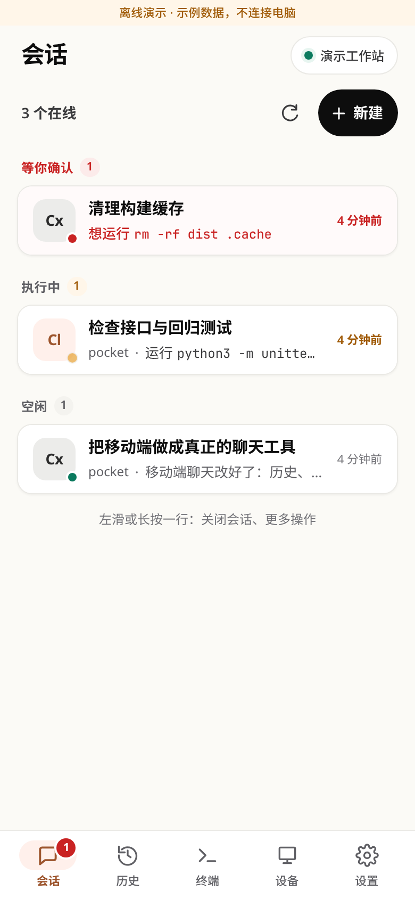
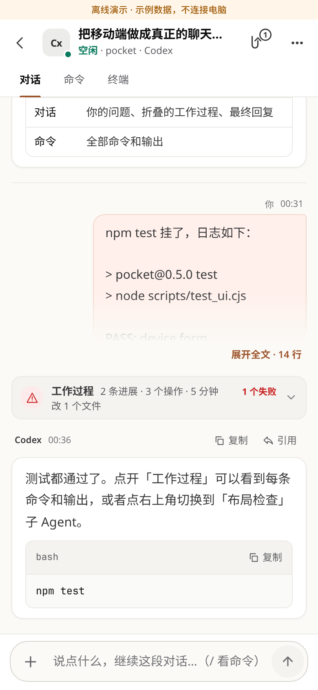
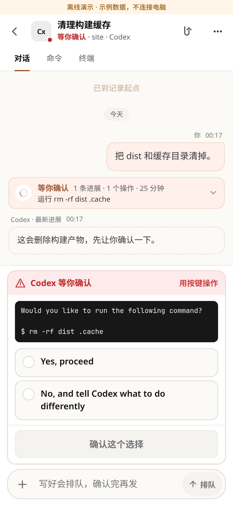
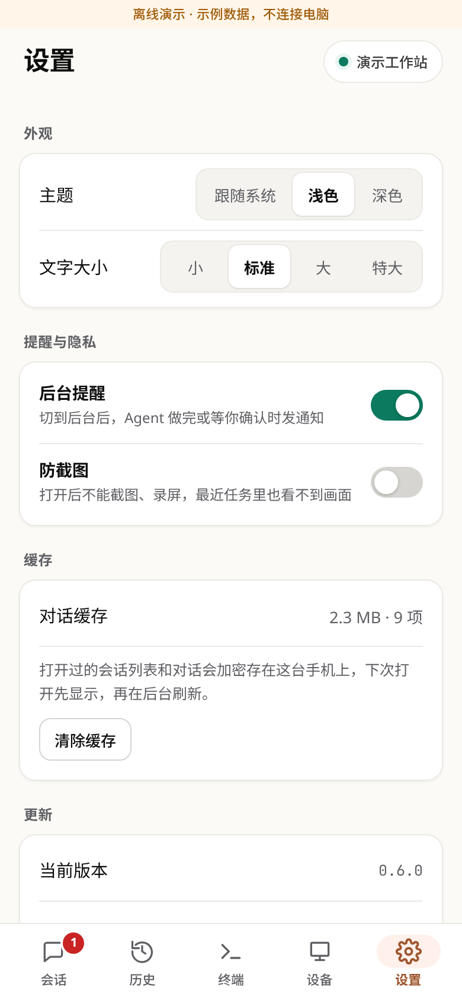
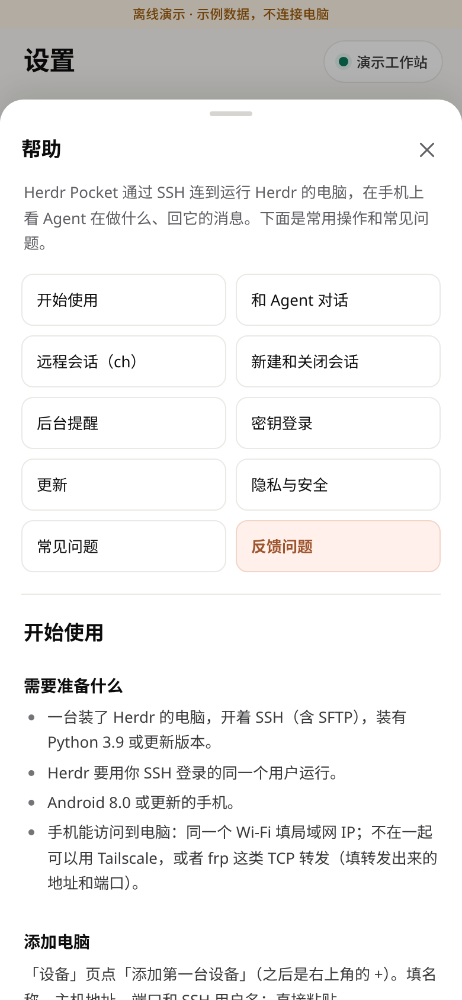
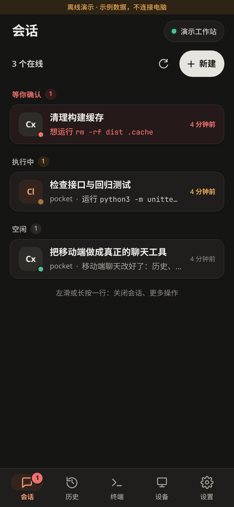
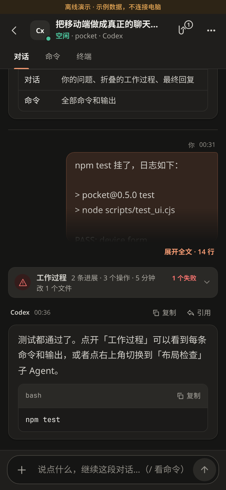
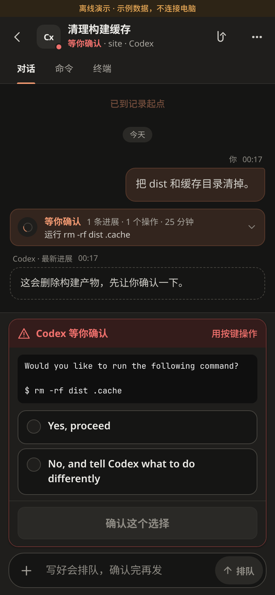
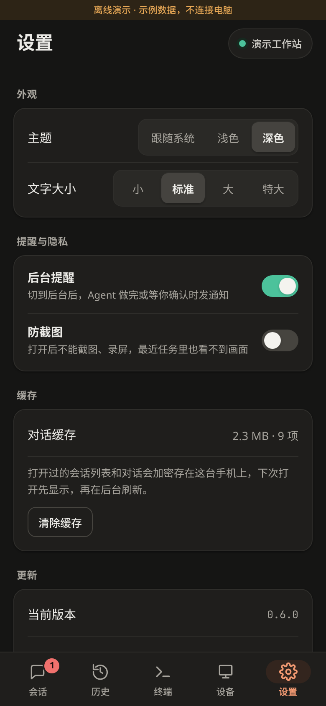
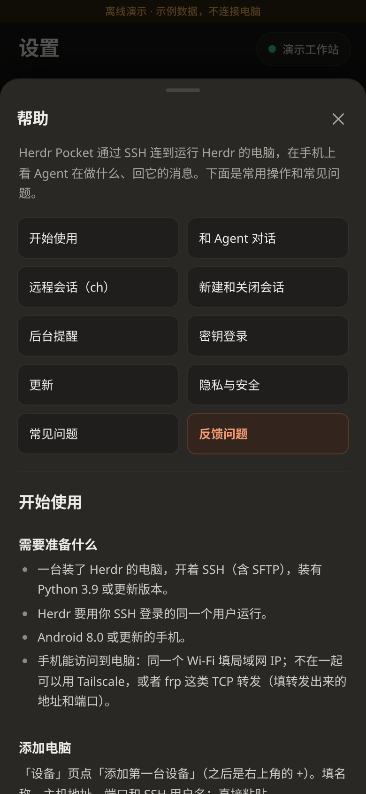

# Herdr Pocket

**在手机上和电脑里的 Claude Code、Codex 对话的开源 Android 客户端。**
**Open-source Android app for chatting with Claude Code and OpenAI Codex CLI agents running in [Herdr](https://herdr.dev) on your computer, over SSH.**

[](https://github.com/HFO4AR/herdr-pocket/releases)
[](https://github.com/HFO4AR/herdr-pocket/actions/workflows/build.yml)
[](LICENSE)


Agent 在电脑上跑着，你离开了座位：Herdr Pocket 让你在手机上看它在做什么、回答它的提问、批准或拒绝操作、继续发消息，做完或等你确认时收到通知。它通过 SSH 直连你自己的电脑，没有中转服务器，没有账号。

独立项目，与 Herdr 及其他同名应用无关。

## In English

Herdr Pocket is a **mobile client for AI coding agents**: a phone companion for **Claude Code** and the **OpenAI Codex CLI** when they run inside [Herdr](https://herdr.dev), a tmux-like terminal workspace for coding agents. It connects straight to your own computer over **SSH** (no relay, no cloud account) and lets you:

- read each agent's conversation as a chat, with tool calls folded into a short "work" summary;
- **approve tool calls from your phone** or answer an agent's question with real buttons;
- send messages, pictures and files, queue a message while the agent is busy, interrupt it, run slash commands;
- get **push notifications** when an agent finishes or waits for you (a read-only background check);
- start and close Codex / Claude sessions, browse past transcripts, and use a plain SSH terminal;
- drive any other agent Herdr detects (OpenCode, Gemini CLI, Kimi, Devin …) the same way: status, prompts, queue, keys, menus and close. Their replies are shown from the terminal screen; transcripts are read for Claude Code and Codex only.

The UI is Chinese. It is MIT-licensed, ships its small Python bridge inside the APK, and keeps credentials encrypted with the Android Keystore. See [SECURITY.md](SECURITY.md).

## 截图

截图全部来自 App 自带的离线演示，没有真实对话或账号。

| 会话列表 | 对话 | 等你确认 | 设置 | 帮助 |
|---|---|---|---|---|
|  |  |  |  |  |
|  |  |  |  |  |

## 能做什么

- **会话列表**：按「等你确认 / 执行中 / 空闲」分组，每行一句预览（正在做什么、在问什么、上次回复的开头），底栏角标显示等你确认的数量。
- **像聊天一样的对话**：每轮的命令和进展折叠成「工作过程」，回复突出显示；完整 Markdown、代码块一键复制；「命令」视图列出全部命令和输出，「终端」视图看窗格画面。
- **回答提问、批准操作**：Agent 问你问题或要你批准时，直接点选项；App 移动光标、核对屏幕上那一行再按 Enter。也可以改用 ↑ ↓ Enter Esc 按键。
- **发消息**：Agent 忙的时候写好会排队，停下就按顺序发；「立即发送」先打断再发；「中断」发送 Esc，不会退出 Agent。输入 `/` 列出斜杠命令。
- **图片和文件**：一条最多 4 张图、4 个文件（单个 ≤ 25 MB）。图片在手机上压缩并去掉 EXIF，经 SFTP 传到电脑 `~/.herdr-pocket/uploads/`，14 天后清理。也可以从别的应用分享进来，先放进草稿，不会自动发送。
- **新建和关闭会话**：在手机上开新的 Codex、Claude 或 Claude · ch 会话（选目录和工作区，不抢电脑焦点）；结束 Agent 或关闭窗格前都要确认。
- **其他 Agent**：Herdr 认得的 Agent（OpenCode、Gemini、Kimi、Devin 等）都会出现在会话列表里，能发消息、排队、按键、回答菜单和关闭；它们的对话记录 App 还读不了，打开后直接看终端画面。
- **远程会话（ch）**：窗格通过 ch 连到另一台电脑时，经同一条 SSH 路由只读读取那台电脑上的对话记录，图片和文件也能送过去。
- **历史**：浏览当前 SSH 用户的 Codex / Claude 本地记录，按天分组、搜索、按子 Agent 筛选；Agent 退出后也能只读查看。
- **后台提醒**：切到后台后只读查状态（有 Agent 在干活时每 20 秒，都停着时每 60 秒），做完、等你确认或 Codex 在问你时发通知（同一个问题只提醒一次，「暂不回答」的不再提醒），点通知直接进那个对话；8 小时、连续失败或回到 App 时自动停止，回到 App 时收起等你处理的通知。
- **打开就有内容**：上次的列表和最近的对话加密缓存在手机上，连接时先显示，连上再刷新。
- **终端**：独立的 SSH 终端，以及 Herdr 里普通窗格的读取和输入。
- **设置与帮助**：浅色 / 深色 / 跟随系统、文字大小、防截图（默认关）、缓存、App 内更新；「设置 → 帮助与反馈」里有使用说明、常见问题和不含隐私的诊断信息。

## 安装

1. 从 [Releases](https://github.com/HFO4AR/herdr-pocket/releases) 下载最新的 APK（每个版本附 SHA-256），安装需要 Android 8.0 或更新版本。
2. 之后在 App 里更新：打开时最多每 12 小时查一次新版本，「设置 → 更新」下载后核对 SHA-256、包名、版本号和签名，再交给系统安装程序确认。

从 `preview-7` 起所有版本用同一个签名，可以直接覆盖升级。签名证书指纹见 [SECURITY.md](SECURITY.md#distribution-signing)。

## 电脑上需要什么

- SSH 服务（含 SFTP），能用密码或密钥登录。
- Python 3.9 或更新版本（桥接程序靠它运行）。
- [Herdr](https://herdr.dev) 或 tmux，至少一个，用你 SSH 登录的同一个用户运行：
  - Codex、Claude 和其他 Agent 要 Herdr（`herdr` 在 PATH 或 `~/.local/bin` 里）。
  - 只用终端，或者 Claude / Codex 跑在 tmux 里，有 tmux 就够了。
- 手机能访问到它：同一个 Wi-Fi、Tailscale，或 frp 这类 TCP 转发（目标指向电脑的 SSH 端口）。

## 开始使用

1. 「设备」→「添加第一台设备」：填主机、端口、SSH 用户名（可以直接粘贴 `user@host:port`），选择密码或密钥登录；设备名称可不填，默认用主机地址。
2. 第一次连接时核对电脑的 SSH 指纹：在电脑上运行 `ssh-keygen -lf /etc/ssh/ssh_host_ed25519_key.pub`，一致再点「信任并连接」。之后指纹变了 App 会拒绝连接。
3. 按提示安装桥接程序：App 自带，经 SFTP 写到 `~/.herdr-pocket/`，按 SHA-256 命名并回读校验；不用 sudo、不重启 Herdr、不开放端口。也可以在电脑上执行 `python3 scripts/install_bridge.py`。
4. 「会话」里点一个 Agent 开始对话。想先看看效果，点「体验聊天演示」（离线，不连接任何电脑）。

### 同时连几台电脑

最多同时连 4 台：连新的一台不会断开已经连着的。连着两台以上时，「会话」顶部有一排电脑可以一点切换，右上角的设备标签也能切；切过去直接显示那台电脑上次的列表和对话，不用重新登录。每台电脑的草稿、排队消息各归各的，排队的消息只会发到写它时的那台电脑。在「设备」里可以单独断开某一台；后台通知里的「断开」会断开全部，提醒会写明是哪台电脑。

### 远程窗格（ch）

窗格里跑的是 ch 时，Agent 实际在另一台电脑上。Herdr Pocket 复用这个窗格已经建立的 SSH 路由（`BatchMode=yes`、严格核对主机指纹、不转发）去那台电脑只读读取对应记录，所以会比本机慢一点，列表上也没有预览。图片用 `ch share-image` 变成 `ch-file://` 地址，文件先复制到那台电脑的上传目录。关闭时「只关本机窗格」会保留远端会话，可以用 `ch resume` 接回。

### 密钥登录

「设备」→「登录密钥」：在手机上生成 Ed25519 密钥，或导入已有私钥（支持带密码的）。私钥用 Android Keystore 加密保存，不显示、不导出。已经能用密码连上时点「装公钥」，确认那一行后 App 追加到电脑的 `~/.ssh/authorized_keys`（不重复写，权限 700 / 600，其他行不动）并试登一次；成功后可以改成密钥登录、删掉保存的密码。也可以复制一行命令自己在电脑上执行。

## 安全与隐私

- 只连两个地方：你的电脑（SSH），以及 GitHub（检查和下载更新，可关闭）。界面打包在 APK 里，不加载网页或远程脚本；没有统计和广告。
- 首次连接手动核对主机指纹；指纹变化一律拒绝，自动重连也只认已信任的指纹。
- 设备资料、保存的密码、登录私钥和本地缓存都用 Android Keystore 的密钥 AES-GCM 加密；Android 备份关闭。
- 只读 Codex / Claude 的对话记录，不读它们的登录凭据和配置；不显示隐藏推理和系统消息。
- 每个会改变状态的请求都带唯一 ID 和回执；结果不确定时绝不自动重发。后台提醒只做只读查询。
- 不自动批准任何确认，不擅自新建或恢复 Agent。

完整说明见 [SECURITY.md](SECURITY.md)，协议见 [docs/PROTOCOL.md](docs/PROTOCOL.md)。

## 常见问题

- **连不上**：错误横幅的标题就是原因（密码不对、端口没开、超时……），点「怎么回事」看对应说明。检查地址、端口，以及手机是否和电脑在同一网络 / Tailscale 是否开着。
- **提示 Herdr 没找到或没在运行**：确认 `herdr` 在这个 SSH 用户的 PATH 或 `~/.local/bin` 里，并且在电脑上开着至少一个 Herdr 会话，再点「重新检查」。
- **消息一直在排队**：排队的消息要等 Agent 停下，并且 App 在前台、对话开着；急的话点「立即发送」。
- **小米等手机收不到通知**：允许通知，省电策略选「无限制」，打开自启动。
- 更多问题在 App 的「设置 → 帮助与反馈」。提 issue 时可以附上那里生成的诊断信息（只有版本、状态、数量和错误代码，不含主机、用户名、路径或消息内容）。

## 开发

结构：`app/` 是 Kotlin Android 外壳和打包进 APK 的离线 WebView 界面（`app/src/main/assets/ui/`，纯 DOM、只插入文本节点）；`bridge/pocket_bridge.py` 是在电脑上运行的桥接程序；`tests/` 是桥接测试，`scripts/` 是浏览器界面测试和工具。

需要 JDK 17、Android SDK 35（Build Tools 35.0.0）、Node.js 和 Python 3.9+。

```sh
python3 -m unittest discover -s tests -v          # 桥接程序
npm ci --ignore-scripts
node scripts/test_markdown.cjs                    # Markdown 渲染
CHROME_BIN=/path/to/chrome npm test               # 离线浏览器界面测试（Playwright，假的原生接口）
./gradlew assembleDebug assembleDebugAndroidTest lintDebug
```

APK 在 `app/build/outputs/apk/debug/app-debug.apk`。浏览器测试只用离线替身；Android Instrumentation 测试真实的 Keystore 加密存储；`scripts/smoke_ui.py` 在模拟器上检查重启后设备仍在、聊天交互完整。

**CI 与发布**：推送到 `main` 后，GitHub Actions 依次跑桥接测试、Markdown 和浏览器界面测试、Android 构建与 lint、Keystore 测试和 API 35 模拟器检查，全部通过才发布带固定签名的 `preview-N` APK 和 SHA-256 文件；`v*` 标签发布对应版本。PR 拿不到签名密钥，也不能发布。维护者需要在仓库 Secrets 配置 `ANDROID_KEYSTORE_BASE64`（JKS，alias `pocket`）和 `ANDROID_KEYSTORE_PASSWORD`；versionCode 为 workflow run number + 100。

贡献前请读 [AGENTS.md](AGENTS.md)：不要提交真实地址、凭据或对话记录，测试中不要向真实 Agent 发送输入。验证记录见 [docs/VALIDATION.md](docs/VALIDATION.md)。

## 关键词

Claude Code 手机客户端 · Codex CLI Android · AI 编程 Agent 远程控制 · 手机批准工具调用 · SSH · Herdr · Claude Code mobile · Codex on Android · remote control for coding agents

## License

MIT。依赖各自保留其许可证，见 [THIRD_PARTY_NOTICES.md](THIRD_PARTY_NOTICES.md)。
