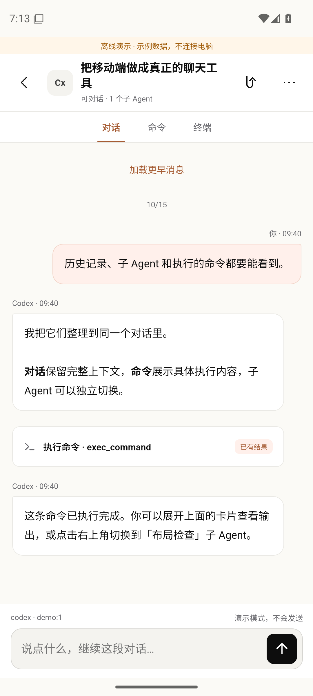
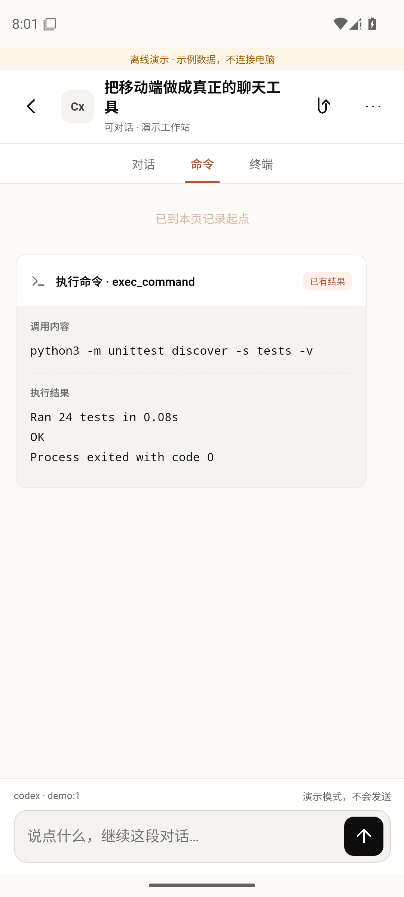
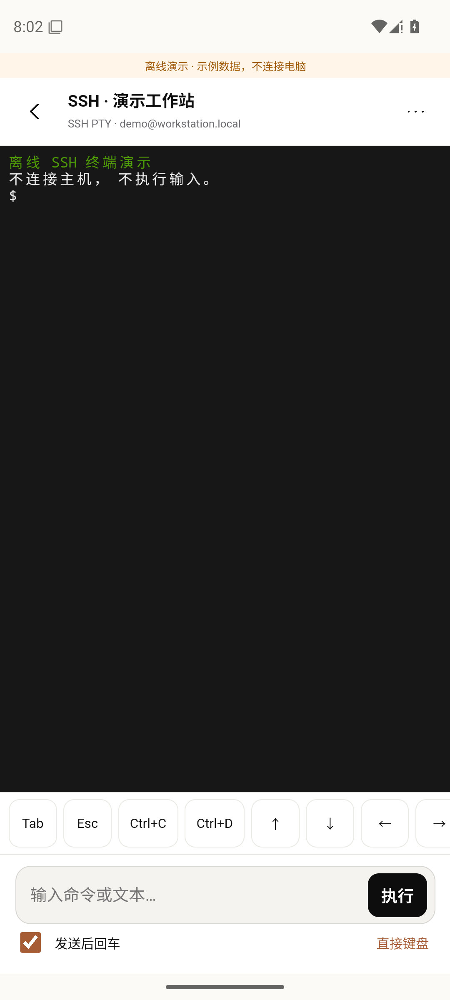
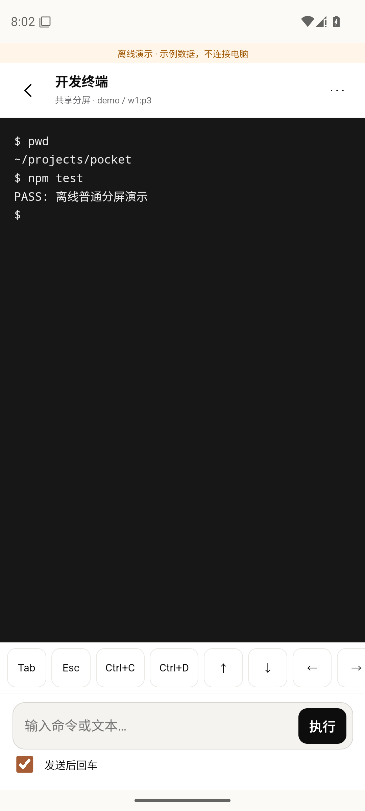

# Herdr Pocket

An independent, open-source Android companion for [Herdr](https://herdr.dev).
Built from scratch in Kotlin, with a small auditable Python bridge carried inside the APK.
Not affiliated with Herdr or other similarly named mobile apps.

**Status: v0.5.0 experimental.** Android SSH companion with a chat UI for live Herdr agents, background alerts and read-only Codex / Claude transcript adapters.

[Download signed APK](https://github.com/HFO4AR/herdr-pocket/releases) · [Build checks](https://github.com/HFO4AR/herdr-pocket/actions)

 

 

Screenshots use offline fixtures, never real conversations or credentials.

视觉采用 Host App 默认亮色 / coral 设计规则：暖白底、珊瑚橙选中态、黑色主按钮，10 / 14 / 20 px 圆角与相同字体顺序。移动端保留至少 44 px 主要触控目标和聊天布局；当前不包含 Host 的深色主题选择器。

## 这版新增（0.5.0）

- **每个窗格都对上正确的对话**：按证据强弱依次使用——Claude 进程正在用的会话目录、Codex 终端标题与会话名、打开的记录文件、Herdr 上报的 ID、启动参数。在 TUI 里切换过会话后，Herdr 上报的 ID 和启动参数都会过期，不再拿它们覆盖更可靠的信号。ch-cli 远端窗格每个远端账号一次 SSH、并行查询，只打开匹配的那一份记录，不再全量索引远端历史。
- **像聊天一样的对话页**：完整 Markdown（列表、表格、引用、带复制的代码块）；连续的工具调用折叠成「执行了 N 个操作」，每条一行摘要和成败标记，点开看完整命令和输出；长按消息复制。
- **实时状态**：Agent 执行时显示「正在工作」条和终端最新一行，可一键中断；等你确认时，输入框上方直接显示终端里的确认提示和 ↑ ↓ Enter Esc Ctrl+C 按键；发出的消息立即上屏。
- **会话列表**按「等你确认 / 执行中 / 空闲」分组，底栏角标提示待确认数量；历史按天分组；账号信息并入「设备」页，底栏四个入口。
- **断线自动重连**：手机锁屏或切网后，下一次操作前用已保存（或本次运行中输入过）的密码和已信任的主机指纹静默重连。只在确定请求还没发出去时才重连后发送；已发出但结果未知的指令仍不会重发；主机指纹变化时拒绝重连。
- **后台提醒**：切到后台时启动前台服务，每 20 秒只读查询一次 Agent 状态，完成或等你确认时发通知，点通知直接打开那个 Agent。回到 App、断开设备、连续失败或 8 小时后自动停止；可在「设备」页关闭。

## 这版能做什么

- **设备与密码保存**：多台设备的名称、主机、端口和 SSH 用户名；勾选记住密码后，使用 Android Keystore 的 AES-GCM 密钥加密，重启应用仍可使用。编辑时不回显密码，取消记住或删除设备会移除保存的密码；改变目的主机或用户名不会沿用旧密码。
- **在线会话**：通过 Herdr CLI 发送消息和按键；草稿按在线会话隔离，切换或旋转时保留在内存中。缺少唯一标识时列出候选历史，可只读查看或人工确认对应关系。
- **历史浏览**：读取当前 SSH 用户 `~/.codex/sessions` 和 `~/.claude/projects` 下的 JSONL，搜索项目/标题/会话 ID，分页加载更早消息。Agent 已退出也能只读浏览。
- **设置**：底部「设置」页可以切换浅色 / 深色 / 跟随系统、调文字大小、开关后台提醒和防截图（默认允许截图），查看并清除对话缓存，检查更新并在 App 里直接下载安装新版（核对 SHA-256 和签名后交给系统安装程序）。
- **发图片**：输入框左边的图片按钮，从相册选或直接拍照，一条消息最多 4 张。手机上先压缩（长边 ≤ 2048 px）并去掉拍摄地点等 EXIF，经 SFTP 传到电脑 `~/.herdr-pocket/uploads/`（14 天后清理），再把路径附在消息后面交给 Agent；通过 ch 连到别的电脑的窗格改用 `ch share-image` 的 `ch-file://` 地址。历史里的这些图片和对话里粘贴的截图会显示缩略图，点开看大图。
- **发文件**：附件按钮里选「文件」（系统文件选择器，不要存储权限），PDF、日志、压缩包、代码都行，一条消息最多 4 个、单个不超过 25 MB。手机边传边算 SHA-256，经 SFTP 放到电脑 `~/.herdr-pocket/uploads/<日期>/<哈希前缀>/<原文件名>`，消息后面附 `[文件] <路径>`；通过 ch 连到别的电脑的窗格，会先经同一条 SSH 路由把文件复制到那台电脑的同一目录（只写这个目录，不覆盖不同的文件），失败就不发。历史里显示成文件卡片，点开可复制路径；14 天后清理。
- **命令与结果**：工具调用和结果按 call ID 关联，「命令」视图列出全部命令和输出。
- **子 Agent**：根据实际父子元数据进入独立子会话并返回父会话；不会把对子记录的操作发给父终端。
- **终端**：独立 SSH PTY shell（彩色输出、Tab、方向键、Ctrl+C）；以及 Herdr 里的普通分屏，读取近期输出、发送文本和快捷键。
- **打开就有内容**：上次的会话列表、历史目录和最近看过的对话（每段最近 80 条）缓存在手机上，打开 App、连接还没完成时先显示出来，标着「上次读取 · 几分钟前」，连上后在原地刷新。连接完成前缓存内容只读，不能发送。
- **适配与动效**：小屏/横屏/宽屏布局，输入区随键盘调整；尊重系统减少动画设置。

## 连接

1. 电脑安装 Herdr、Python **3.9+**，开启 SSH/SFTP，并以同一用户运行 Herdr。
2. 安装 APK（Android **8.0+**），在「设备」添加连接；想下次直接连接时勾选「记住密码」。
3. 首次连接核对 SSH 主机指纹。已有主机密钥变化时拒绝连接，不自动接受替换。
4. 按 App 提示安装/更新桥接程序。程序写入 `~/.herdr-pocket/bridge-<sha256>.py`，回读校验；无需 sudo，不重启 Herdr，也不开放额外端口。
5. 「会话」继续在线 Agent；「历史」浏览持久记录；「设备」查看 SSH 连接信息、开关后台提醒。

Sakura Frp 使用 **TCP 隧道，目标指向运行 Herdr 的电脑 SSH 端口**。树莓派可作为 frpc 客户端；App 填公网域名和分配的端口。不要把实际地址、密码或隧道凭据提交到 Git。

也可在电脑以 SSH 用户执行 `python3 scripts/install_bridge.py`，安装与当前源码严格匹配的桥接版本。

## 隐私与边界

- SSH 是唯一网络传输。SSH 终端使用同一已验证连接上的独立 shell 通道。界面 HTML/CSS/JS 内置于 APK，不加载网站、CDN 或远程脚本；禁用 WebView 网络资源、外部导航、文件和内容 URL。
- 保存的设备资料和密码全部加密存于 App 私有存储，密钥留在 Android Keystore。Android 备份关闭。没有分析统计或广告。
- 历史正文按需读取，不复制到电脑索引缓存；私有缓存只保存标题和会话元数据。草稿仅在内存中；手机上的会话列表/对话缓存按设备加密保存（见下）。
- 会话列表、历史目录和最近对话的缓存放在 App 私有的不备份目录，按设备分开，用单独的 Android Keystore 密钥 AES-GCM 加密；单条最多 1.5 MB、总共最多 32 MB，超出先删最久没用的。删除设备会删掉它的缓存，也可以在「设置」里清除缓存。演示模式从不写缓存。
- 不读取 Codex/Claude 登录凭据，不显示隐藏推理或系统/开发者消息；内部 guardian 记录不作为用户会话列出。
- 历史与子 Agent 浏览是**只读**。不存在明确在线窗格绑定时不提供发送，不擅自恢复或创建 Agent。
- 本地记录可能已删除、截断或随上游格式变化；当前是有界分页读取，每个消息/工具块最多 16 KB，并标记截断，不承诺找回未持久化的内容。图片缩略图只从上传目录、ch 附件缓存或对话记录本身读取，单张最多 1.35 MB。
- 原会话 ID 不可用时不按目录/标题猜测发送目标；人工关联会列出目标窗格和历史 ID，必须在 App 中明确确认。换 Agent 时重新验证身份；发送超时保留草稿，不自动重发。
- 前台对话定时刷新（Agent 执行中更快）。后台提醒只做只读状态查询，不发送任何输入；系统杀掉进程后连接和内存草稿会丢失，保存的设备与密码不受影响。自动重连不会弹出新的主机指纹确认，只接受之前已信任的指纹。

## 构建与验证

JDK 17、Android SDK 35、Build Tools 35.0.0。

```sh
./gradlew assembleDebug assembleDebugAndroidTest lintDebug
python3 -m unittest discover -s tests -v
npm ci --ignore-scripts
CHROME_BIN=/path/to/google-chrome npm test
```

APK：`app/build/outputs/apk/debug/app-debug.apk`。浏览器测试只使用离线原生接口替身，Android Instrumentation 单独验证真实 Keystore 加密存储；模拟器执行 `scripts/smoke_ui.py` 验证应用重启后的设备保存和完整聊天交互。

## 自动发布

推送 `main` 后自动运行桥接测试、聊天浏览器检查、Android 构建/lint、Keystore 测试和 API 35 模拟器交互检查。全部通过才发布带固定签名的 `preview-N` APK 与 SHA-256 文件。`v*` 标签发布对应版本，带 `-` 的版本标为预发布。PR 不获得签名 Secret 或发布权限。

从 `preview-7` 开始使用同一独立签名，可覆盖升级。仅最早的 `v0.1.0-alpha.1` 调试签名版本需要卸载一次再安装。

维护者配置仓库 Actions Secrets：`ANDROID_KEYSTORE_BASE64`（JKS，alias 为 `pocket`）和 `ANDROID_KEYSTORE_PASSWORD`。私钥不要入库，需安全备份。CI 仅在 runner 临时目录解码签名文件，签名后删除。versionCode 使用 workflow run number + 100，迁移工作流时保持递增。

协议与验证记录见 [PROTOCOL](docs/PROTOCOL.md)、[SECURITY](SECURITY.md) 和 [VALIDATION](docs/VALIDATION.md)。

## License

MIT. Dependencies retain their licenses; see [THIRD_PARTY_NOTICES.md](THIRD_PARTY_NOTICES.md).
